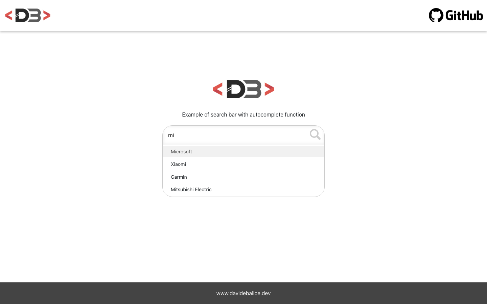

# React Search Bar with Autocomplete

A search bar with autocomplete built with React. While you type, it suggests matching items from a list of brands, and suggestions can be picked with the mouse or the keyboard.

**Live demo:** <https://autocomplete.davidebalice.dev/>



## Features

- Case-insensitive filtering of suggestions while typing
- Keyboard navigation: arrow up/down to move through suggestions, Enter to select
- Click on a suggestion to select it
- Reusable `Autocomplete` component that accepts any array of strings via the `options` prop
- Responsive layout

## Tech stack

- [React 18](https://react.dev/) (Create React App)
- [React Bootstrap](https://react-bootstrap.github.io/) / [Bootstrap 5](https://getbootstrap.com/)
- CSS Modules

## Getting started

### Requirements

- Node.js 18 or later
- npm

### Installation

```bash
git clone https://github.com/davidebalice/react-autocomplete.git
cd react-autocomplete
npm install
```

### Available scripts

| Command         | Description                             |
| --------------- | --------------------------------------- |
| `npm start`     | Start the development server            |
| `npm run build` | Create a production build in `build/`   |
| `npm test`      | Run the tests                           |

### Usage

```jsx
import Autocomplete from "./components/Autocomplete";
import brands from "./data/brands";

<Autocomplete options={brands} />
```

## Project structure

```
src/
├── common/       # Header, footer and layout wrapper
├── components/   # Autocomplete and description
└── data/         # List of brands used as suggestions
```

## Author

**Davide Balice** – [davidebalice.dev](https://www.davidebalice.dev)
